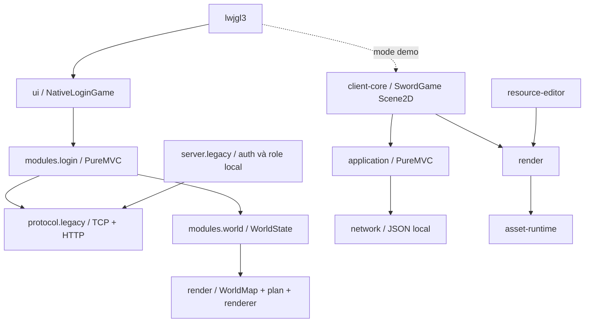

# Client libGDX native theo module

Mở `SwordOL-Native.cmd`. Desktop entry hiện là màn hình native login/role dùng giao thức cũ; thử bằng `Server-Native.cmd` với tài khoản local tự đặt, xem [native-login.md](native-login.md). Đây là source Java/libGDX thật, không nạp JAR game gốc hoặc Emulator.jar. Bản đồ gốc đã dựng và đi lại được qua gateway local ([native-world.md](native-world.md)); sprite nhân vật, combat, vật phẩm, NPC và nghiệp vụ đầy đủ của client cũ còn chưa hoàn tất. JSON demo cũ chỉ mở bằng `-Dswordol.demo=true`.

## Module là package trong cùng client-core

| Module | Sở hữu | Không sở hữu |
|---|---|---|
| `vn.swordol.client.modules.login` | GameSession và PureMVC cho cả phiên native: login/role và world | GL, luật combat |
| `vn.swordol.client.modules.world` | WorldState (lưới, nhân vật, người khác, portal, bước đi), WorldListener/WorldView | socket, GL, PureMVC |
| `vn.swordol.client.ui` | NativeLoginGame, màn hình đăng nhập/nhân vật mặc định desktop | blocking IO |
| `vn.swordol.client.network` | JsonConnection, socket, giới hạn frame, timeout, heartbeat, generation, callback dispatcher | PureMVC, libGDX, luật gameplay |
| `vn.swordol.client.application` | GameFacade, Command, NetworkProxy, GameMediator, GameView | GL, Scene2D, socket trực tiếp |
| `vn.swordol.client.render` | MapCatalog, WorldSync, MapRenderer, TileSheets, WorldMap/MapPlan/MapView/TileImages/WorldRenderer | tài khoản, network, PureMVC |
| `vn.swordol.client.SwordGame` | SwordGame, Scene2D, input, composition và tài nguyên UI | TCP worker và điều phối nghiệp vụ |
| `lwjgl3` | cửa sổ, launcher, shaded desktop JAR | luật server |
| `asset-runtime` | đọc bundle, kiểm tra toàn vẹn, model map | giao diện/game loop |
| `vn.swordol.protocol.wire` (trong protocol có sẵn) | TCP/HTTP framing, CRC/XOR, typed writer/reader và login schema | socket, luật server |
| `protocol` | hợp đồng JSON local và package decoder legacy inbound riêng | luật gameplay, auth production |

Giữ một project client-core, chia module bằng package; không tạo các Maven project client-network/client-application/client-render riêng. Launcher Android/iOS vẫn dùng SwordGame ở package cũ. Editor và game dùng chung package render. Các ranh giới package được giữ bằng thiết kế và kiểm thử; Maven không cưỡng chế dependency giữa package.



## Mẫu thiết kế được áp dụng

PureMVC là cơ chế điều phối chính: **Facade** là cổng use case; **Command** nhận intent và xử lý response; **Proxy** chuyển callback mạng thành notification; **Mediator** nối view với intent/state. **Adapter** JsonConnection tách IO khỏi framework. **GameView** là cổng presentation để test không cần GL. **MapRenderer.Tiles** cung cấp ảnh tile cho renderer dùng chung editor/game.

Không thêm event bus hoặc service locator thứ hai. Callback mạng được xếp vào dispatcher do app cung cấp (`Gdx.app.postRunnable` ở desktop); GL/UI chỉ cập nhật trên render thread. Generation loại response của phiên đã ngắt. Remove mediator nhả view và disconnect; remove proxy đóng worker. Assets/texture được giải phóng theo lifecycle ứng dụng.

## Trạng thái tính năng native

| Nhóm | Hiện chạy được | Còn phải làm |
|---|---|---|
| Session | binary account HTTP → game TCP → role → tài nguyên map → vào bản đồ; disconnect/cancel, local gateway kiểm chứng | live acceptance, HTTP gameplay/WAP, create role, session đầy đủ |
| World | map gốc1407/1110/1126 dựng và vẽ đúng3 lớp, nhân vật theo1006, đi lại1005 có ô chặn và correction | animation, nội suy bước đi, chuyển map qua portal, đồng bộ nhiều entity |
| Combat | request attack và state demo | skill/action/target native, đối chiếu battle packet; luật mới có phiên bản |
| UI | Scene2D login/role, màn hình thế giới với HUD và phím đi | túi đồ, NPC, skill, quest, chat đầy đủ |
| Tài nguyên | pipeline giải mã, renderer dùng chung, ảnh tile map tải từ bundle hoặc thư mục PNG | atlas thay vì một texture mỗi ảnh, animation entity, layout UI gốc |
| Giao thức cũ | writer/reader TCP, CRC/XOR outbound, HTTP account batch và login/role session có kiểm thử local | HTTP gameplay, WAP, packet nghiệp vụ world/combat/item và live acceptance |

Không tạo module inventory/skill/quest rỗng rồi coi là hoàn tất. Khi triển khai sẽ nhóm theo feature trong application và UI; chỉ tách artifact tiếp nếu có dữ liệu/logic dùng chung hoặc ranh giới build cần giữ.

## Build và kiểm chứng

```powershell
powershell -ExecutionPolicy Bypass -File scripts/mvn.ps1 -o clean verify
powershell -ExecutionPolicy Bypass -File scripts/run-native-desktop.ps1 -SmokeFrames 180 -Screenshot screenshots/native-modules.png
```

`classic-desktop`/`SwordOL-libGDX.cmd` vẫn là bản tương thích gốc để đối chiếu. Client native mở bằng `SwordOL-Native.cmd`. Đánh giá server: [server-reconstruction-assessment.md](analysis/server-reconstruction-assessment.md).
